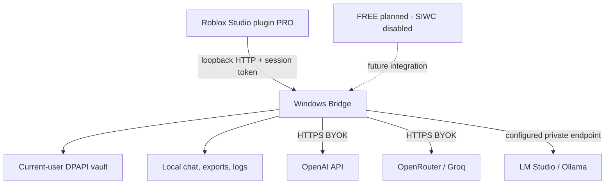

# Architecture and execution boundaries
The Roblox Studio plugin (Luau) provides chat, model selection, project-context collection, tool calls, project modifications, Undo checkpoints and the session Worker queue. Python Bridge is a separate local HTTP server, not a publisher-hosted AI relay. It authenticates requests to providers using the customer's credentials; the plugin interprets model output and performs supported Studio operations. The Bridge does not execute model-generated Luau.

Worker holds at most 30 tasks in Studio session memory. Successful tasks close the Undo checkpoint before a 30-second pause. Explicit 502/503/504 errors may retry, not whole tasks or partial generations. Final failures stop the queue. Automatic provider failover is not implemented. Undo is not a complete disk backup; export omits some geometry. No publisher telemetry backend is present in the inspected source.
