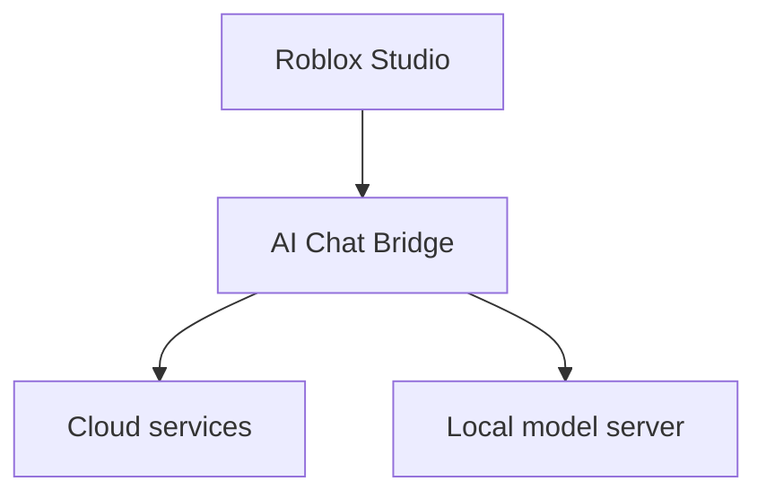

# Architecture

AI Chat PRO consists of a Roblox Studio plugin and a local Windows Bridge.

The plugin prepares project context and performs editing operations. Bridge manages provider communication and credentials. The publisher does not act as an AI billing intermediary.

Worker processes queued tasks. Undo checkpoints support reverting changes but do not replace full project backups.

See [providers](PROVIDERS.md) and [privacy](PRIVACY_POLICY_EN.md).
