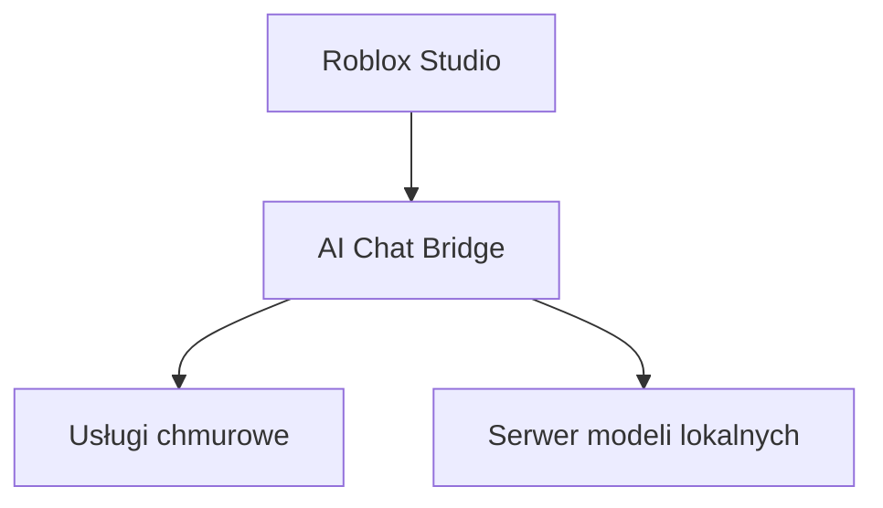

# Architektura

AI Chat PRO składa się z pluginu Roblox Studio oraz lokalnego programu Bridge dla Windows.

## Przepływ pracy

Plugin przygotowuje kontekst projektu i wykonuje operacje edycji. Bridge obsługuje komunikację z wybranym dostawcą oraz zarządzanie kluczami. Wydawca nie pośredniczy w rozliczeniach AI.

Worker wykonuje kolejkę zadań. Punkty Undo umożliwiają cofanie zmian, ale nie zastępują pełnej kopii projektu.

Zobacz [dostawców](PROVIDERS_PL.md) i [prywatność](PRIVACY_POLICY_PL.md).
