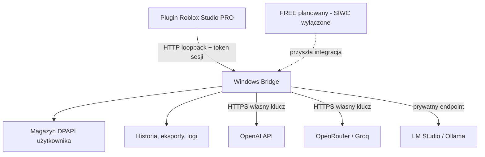

# Architektura i granice wykonania
Plugin Luau w Roblox Studio obsługuje czat, wybór modelu, zbieranie kontekstu projektu, wywołania narzędzi, modyfikacje projektu, punkty Undo i kolejkę Workera. Bridge Python to lokalny serwer HTTP, nie serwer AI wydawcy. Bridge uwierzytelnia zapytania kluczem klienta, plugin interpretuje odpowiedzi i wykonuje obsługiwane operacje Studio. Bridge nie wykonuje kodu Luau wygenerowanego przez model.

Worker mieści do 30 zadań w pamięci sesji Studio. Po sukcesie zamykany jest punkt Undo i następuje 30 s przerwy. Jawne błędy 502/503/504 mogą być ponawiane, lecz nie całe zadania ani częściowe generacje. Błąd końcowy zatrzymuje kolejkę. Failover nie jest wdrożony. Undo nie jest pełną kopią dyskową; eksport pomija część geometrii. W sprawdzonych źródłach nie ma serwera telemetrii wydawcy.
